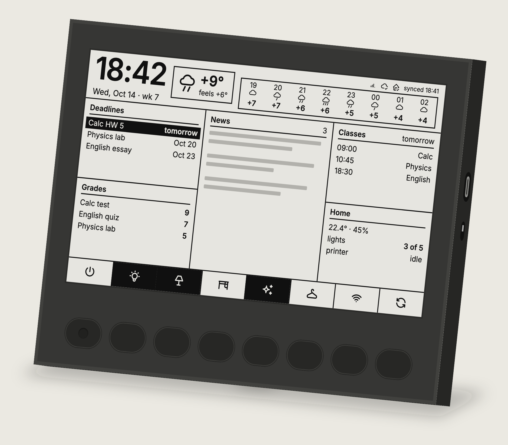
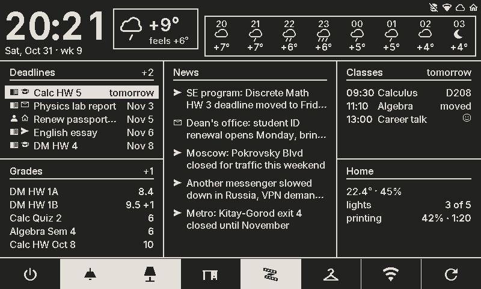
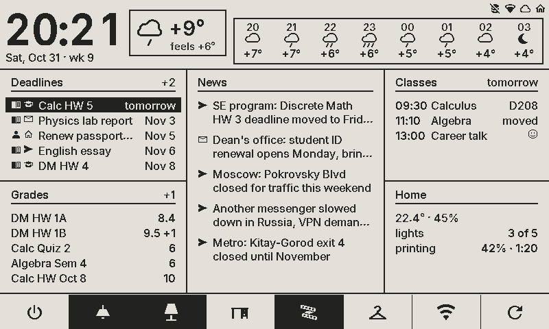
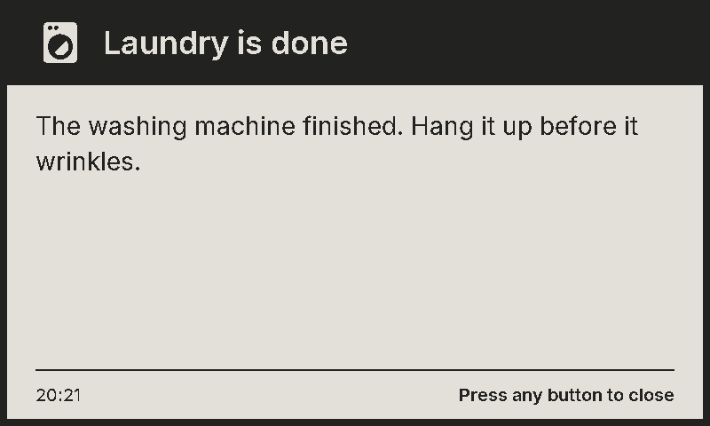
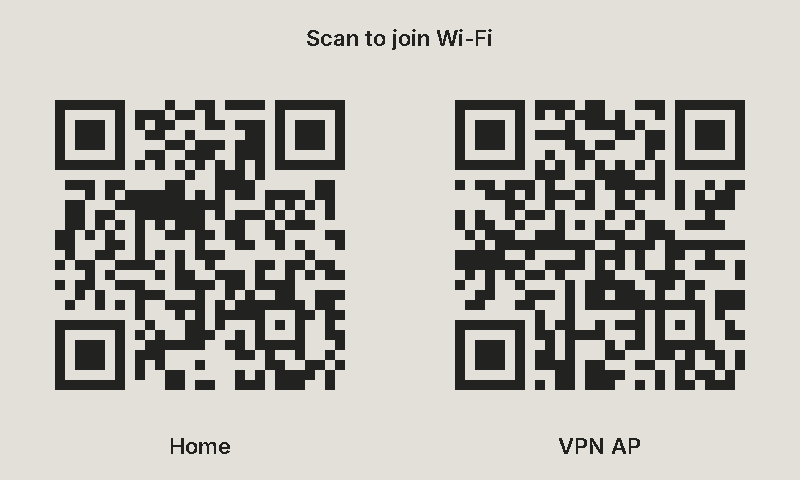
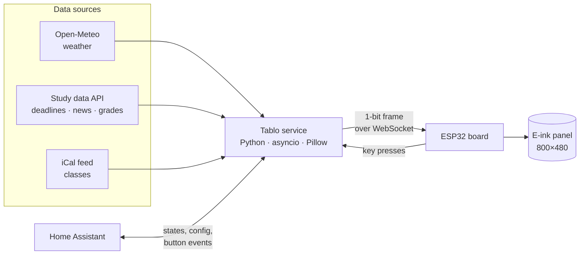
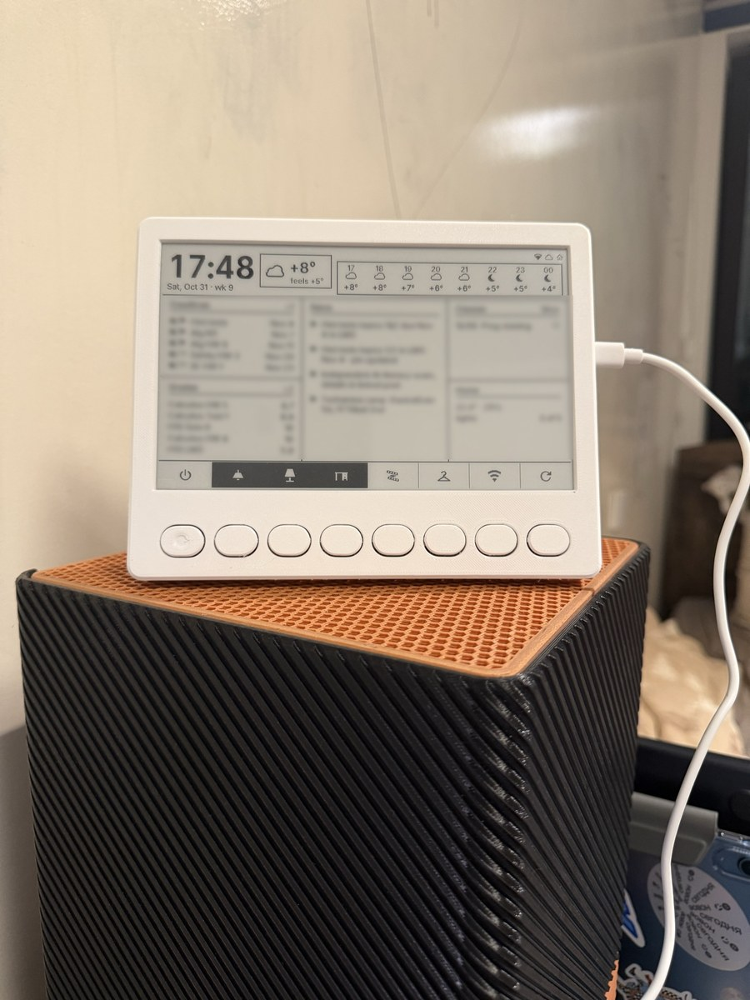
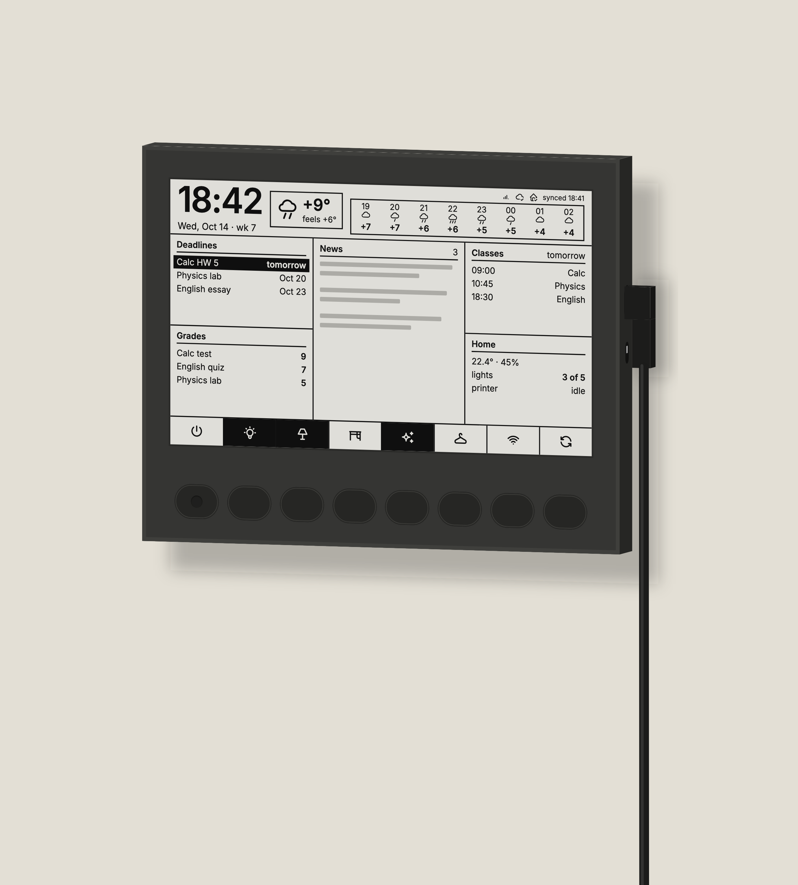
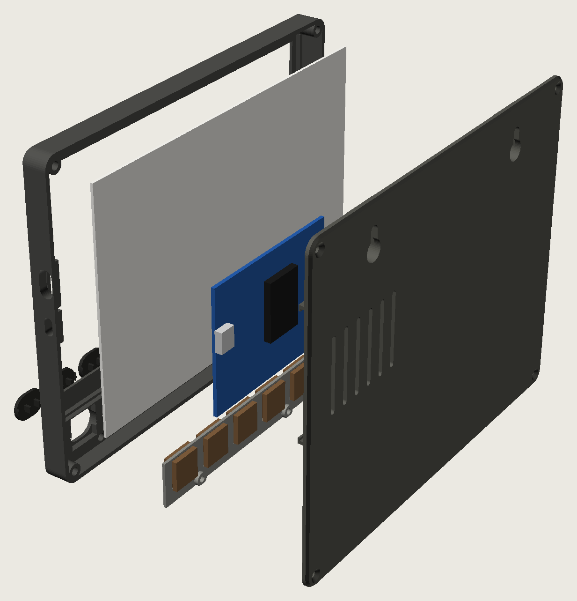
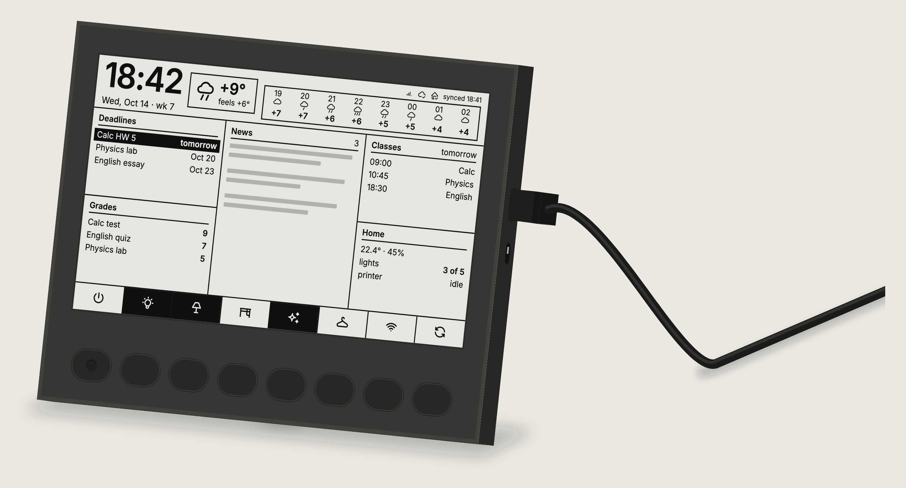

<p align="center">
  
</p>

<h1 align="center">Tablo T75</h1>

<p align="center">
  <b>A 7.5″ e-ink panel that shows your day at a glance — with eight real buttons for your home.</b>
</p>

<p align="center">
  <a href="https://github.com/IvanIkra/tablo-t75/actions/workflows/ci.yml"></a>
  <a href="LICENSE"></a>
  
  
  
  
</p>

<p align="center">
  <a href="#whats-on-the-screen">Screen</a> ·
  <a href="#features">Features</a> ·
  <a href="#how-it-works">How it works</a> ·
  <a href="#hardware">Hardware</a> ·
  <a href="#quick-start">Quick start</a> ·
  <a href="#documentation">Docs</a>
</p>

---

Tablo is a desk or wall panel built around a 7.5″ black-and-white e-ink screen
(800×480). It shows the time, the weather for the next hours, upcoming deadlines,
news, fresh grades, the class schedule and the state of the home. Eight mechanical
keys under the screen control Home Assistant, and the tile above each key shows
whether the thing it controls is on. It runs from USB-C around the clock and reads
like a sheet of paper: no glow, no flicker.

The whole project is open: the Python service, the ESP32 firmware, the Home Assistant
integration and the 3D-printable enclosure.

## What's on the screen

<p align="center">
  
</p>

<p align="center"><sub>A real frame from the service, captured in the browser emulator with demo data. Dark theme is the default.</sub></p>

| Zone | What it shows |
|---|---|
| **Clock and date** | Drawn by the board itself and updated every minute, together with the status icons (Wi-Fi, service, Home Assistant). |
| **Weather** | Now and "feels like", plus an 8-hour forecast from [Open-Meteo](https://open-meteo.com/). |
| **Deadlines** | The nearest ones first; anything due today or tomorrow is highlighted. |
| **News** | A short digest, wrapped and trimmed to fit the column. |
| **Classes** | Today's or tomorrow's classes from an iCal feed, with moved and optional ones marked. |
| **Grades** | The latest grades, with a counter of new ones. |
| **Home** | Any Home Assistant values you like: temperature, how many lights are on, the 3D printer's progress. |
| **Button tiles** | One icon per key; a filled tile means the device is on. |

<details>
<summary><b>Light theme</b></summary>
<br>
<p align="center"></p>
</details>

## Features

- **Smart server, dumb device.** A Python service lays out every frame with Pillow
  and streams it to the board; the ESP32 only shows it. All the logic can change
  without reflashing.
- **Partial refresh by diff.** The board compares each new frame with the one on
  the panel and redraws only what changed, with a full refresh now and then to
  clear ghosting.
- **Instant buttons.** A key press inverts its tile on the board right away, before
  the service even answers. Short and long presses can do different things.
- **Configured from Home Assistant.** Button actions, icons, Wi-Fi, data sources,
  the Home block and the screen settings are all forms in the integration.
- **Full-screen messages.** Show a message from any automation, or a sticky one that
  waits in a queue until someone presses a key.
- **Wi-Fi QR for guests.** One key shows QR codes for your networks.
- **Over-the-air updates** through the service, with a "what's new" screen after
  each new firmware version.
- **A browser emulator** of the whole board, keys included, so the screen can be
  developed without the hardware.
- **A flat printed enclosure** that hangs on the wall or stands on the desk on a
  hidden 15° leg.

<table>
  <tr>
    <td align="center" width="50%"><br><sub>A sticky message from an automation</sub></td>
    <td align="center" width="50%"><br><sub>Wi-Fi QR codes for guests</sub></td>
  </tr>
</table>

## How it works



- **The frame** is 800×480 at 1 bit per pixel: 48 000 bytes behind a small `TBLF`
  header, `1` = black. The service sends a new one only when something changes.
- **The board** keeps its own clock, date and status line, so it stays useful when
  the service is down, and it inverts the whole picture for the dark theme.
- **Buttons 1–7** do whatever Home Assistant tells them to (toggle a light, run a
  script, show the Wi-Fi QR). **Button 8** is fixed: a full refresh, or the
  diagnostics screen on a long press.
- **Secrets** live only in `.env` and in Home Assistant, never in the repository.

## Hardware

<table>
  <tr>
    <td align="center" width="33%"><br><sub>The real thing, running</sub></td>
    <td align="center" width="33%"><br><sub>On the wall</sub></td>
    <td align="center" width="33%"><br><sub>What's inside</sub></td>
  </tr>
  <tr>
    <td align="center" colspan="3"><br><sub>On the desk, on its hidden leg</sub></td>
  </tr>
</table>

| Part | What |
|---|---|
| Screen | Good Display **GDEY075T7**, 7.5″, 800×480, black and white |
| Board | Good Display **ESP32-L(C02)** with the **DESPI-C02** adapter |
| Keys | 8 × **Kailh Choc v1** Brown, low-profile |
| Power | USB-C, 5 V, any 1 A supply |
| Enclosure | 185 × 146 × 17 mm, printed in PLA or PETG without supports |

The enclosure is a parametric [OpenSCAD model](cad/tablo.scad). Ready STLs, the
list of fasteners and the print and assembly guide are in [`cad/`](cad/README.md);
the full bill of materials is in [`docs/hardware.md`](docs/hardware.md#bill-of-materials).

## Quick start

### Try it in the browser

No hardware needed: the service ships with a board emulator and a fake home.

```bash
cd service
uv sync
uv run python -m tablo --config config.yaml
```

Open <http://localhost:8765/emu>. Keys 1–8 on the keyboard press the buttons;
hold one for a long press. Checkboxes under the screen switch each block between
demo and real data. More in [`service/README.md`](service/README.md).

### Run it for real

1. **Service.** Copy `service/.env.example` to `service/.env`, fill in the tokens
   and run it with Docker: `docker compose up -d --build` in `service/`.
2. **Firmware.** Copy `firmware/include/secrets.example.h` to `secrets.h`, set
   Wi-Fi, the service address and the device token, then flash over USB:
   `pio run -e esp32 -t upload`. Later updates go over the air through the service.
3. **Home Assistant.** Copy `ha-integration/custom_components/tablo` into your HA
   config, restart HA and add the **Tablo T75** integration. See
   [`ha-integration/README.md`](ha-integration/README.md).

## Repository layout

| Path | What |
|---|---|
| [`service/`](service/) | The Python service (asyncio, aiohttp, Pillow, SQLite): data sources, layout, the device protocol, the browser emulator and the tests. |
| [`firmware/`](firmware/) | ESP32 firmware (PlatformIO + Arduino): frame buffers and diffing, the on-board clock and status line, keys, diagnostics and OTA. |
| [`ha-integration/`](ha-integration/) | The Home Assistant custom component: config forms, device triggers, `tablo.*` actions, sensors and events. |
| [`cad/`](cad/) | The enclosure in OpenSCAD, with STLs and preview renders. |
| [`docs/`](docs/) | The design documents: hardware, and the software contract split by area. |
| [`presentation/`](presentation/) | Product renders and the project presentation. |

## Documentation

| Document | About |
|---|---|
| [Product and hardware](docs/hardware.md) | What Tablo does, the screen grid, the keys, the parts and the enclosure. |
| [Architecture](docs/software/01-architecture.md) | The system and who draws which zone of the screen. |
| [Protocol](docs/software/02-protocol.md) | Board ↔ service messages, buttons and full-screen overlays. |
| [Service](docs/software/03-service.md) | Stack, layout, HTTP API and config. |
| [Data sources](docs/software/04-sources.md) | Deadlines, news, grades, classes, weather and the home. |
| [Home Assistant](docs/software/05-ha-integration.md) | The integration: forms, actions, triggers, entities. |
| [Emulator and firmware](docs/software/06-emulator-firmware.md) | The browser emulator and the ESP32 firmware. |
| [Failures and deployment](docs/software/07-failures-deploy.md) | What happens when things break, deployment and secrets. |
| [Plan](docs/software/08-plan.md) | The work plan and open questions. |

## Status

The hardware is built and running: the panel lives in its printed enclosure and
shows live frames, the clock, the status line and all eight keys, with diagnostics,
OTA updates and the post-update greeting. The firmware is at **fw-0.7**; what's
left is tuning when the panel switches from partial to full refresh.

## License

[MIT](LICENSE). Bundled third-party assets keep their own licenses:
the [Inter](service/assets/fonts/Inter-LICENSE.txt) font (SIL OFL 1.1) and the
[Material Design Icons](service/assets/mdi/LICENSE) font (Pictogrammers Free License).
