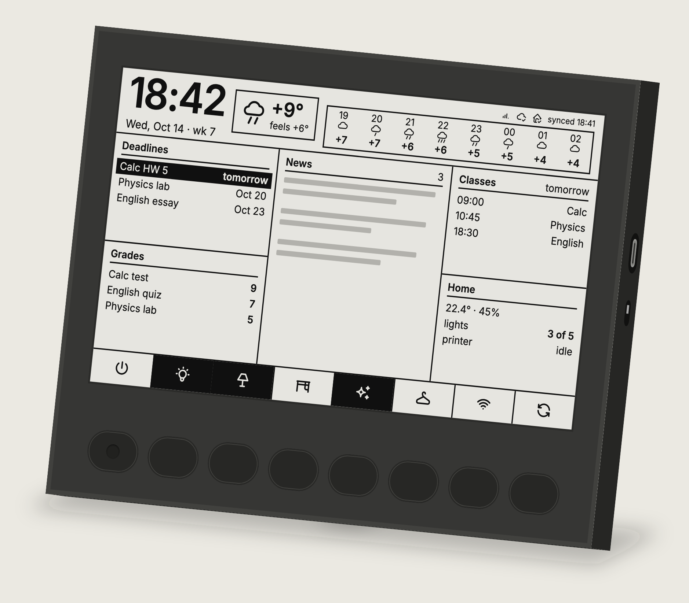
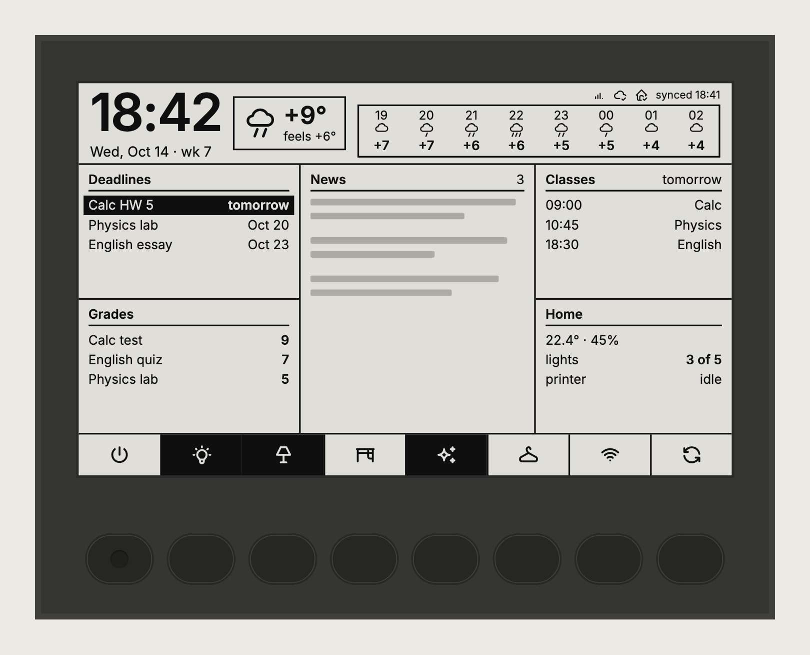
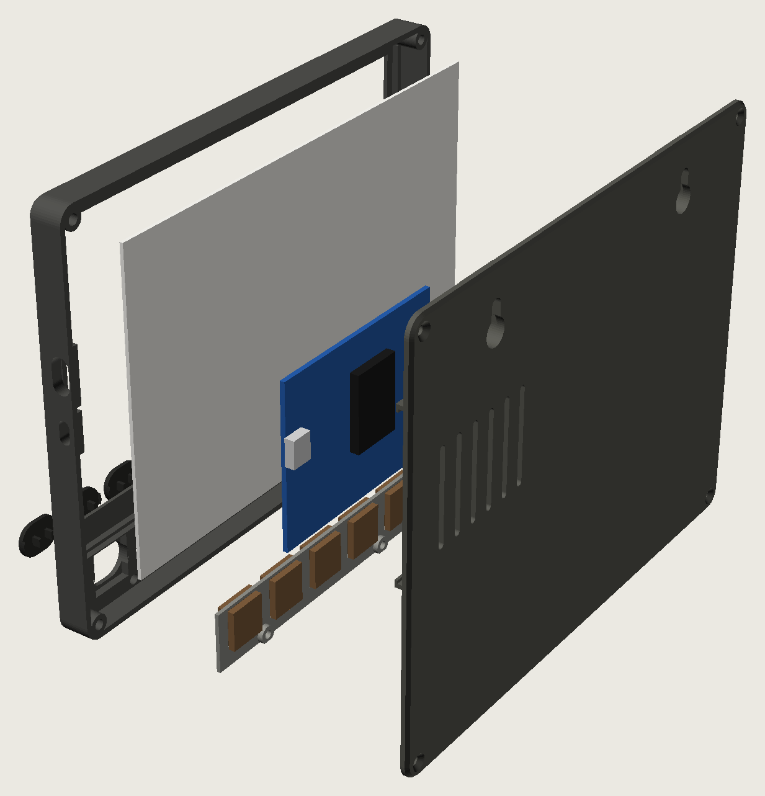
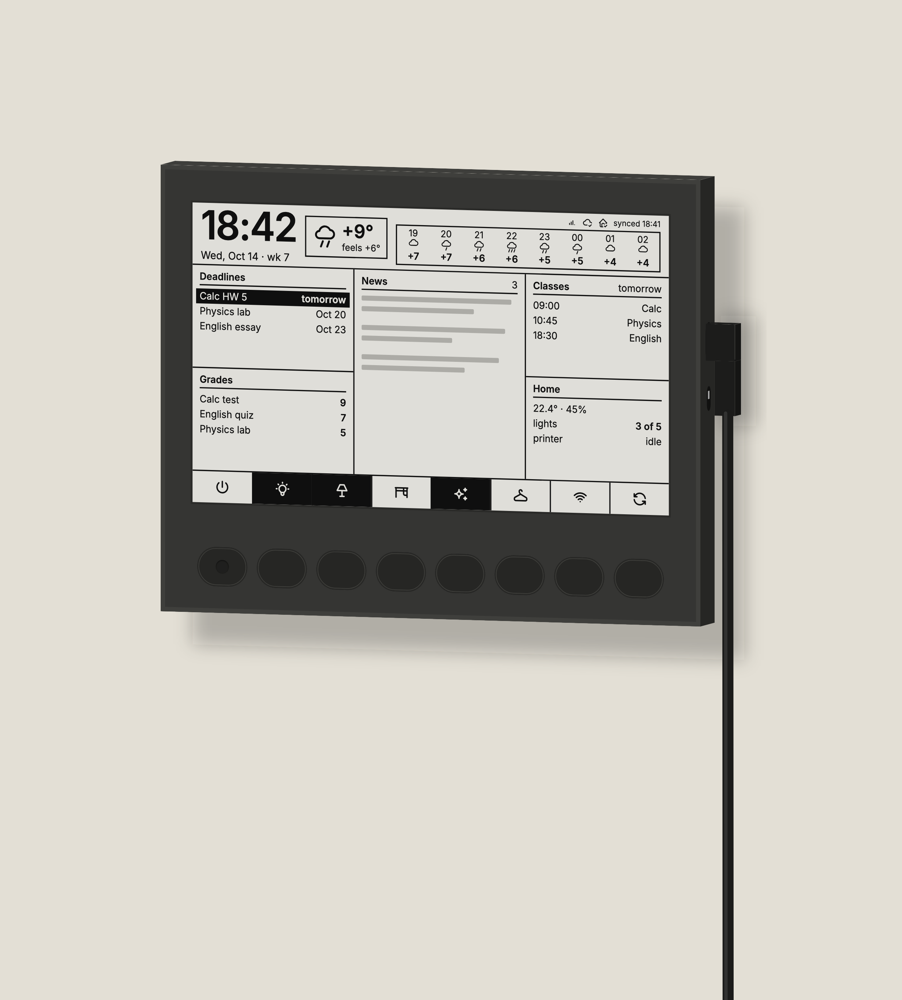
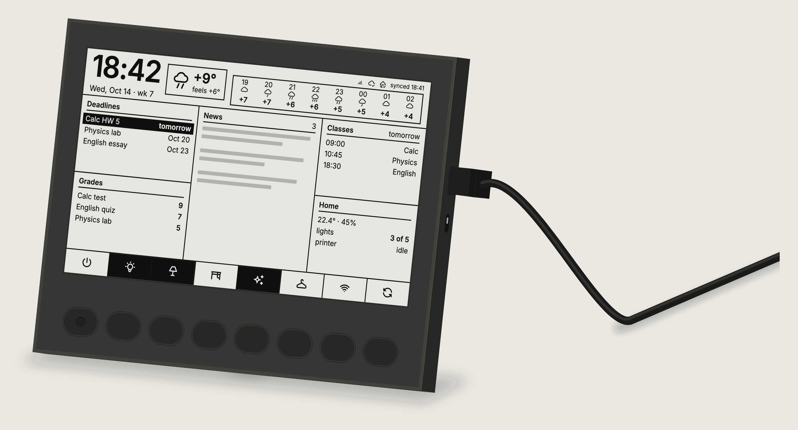
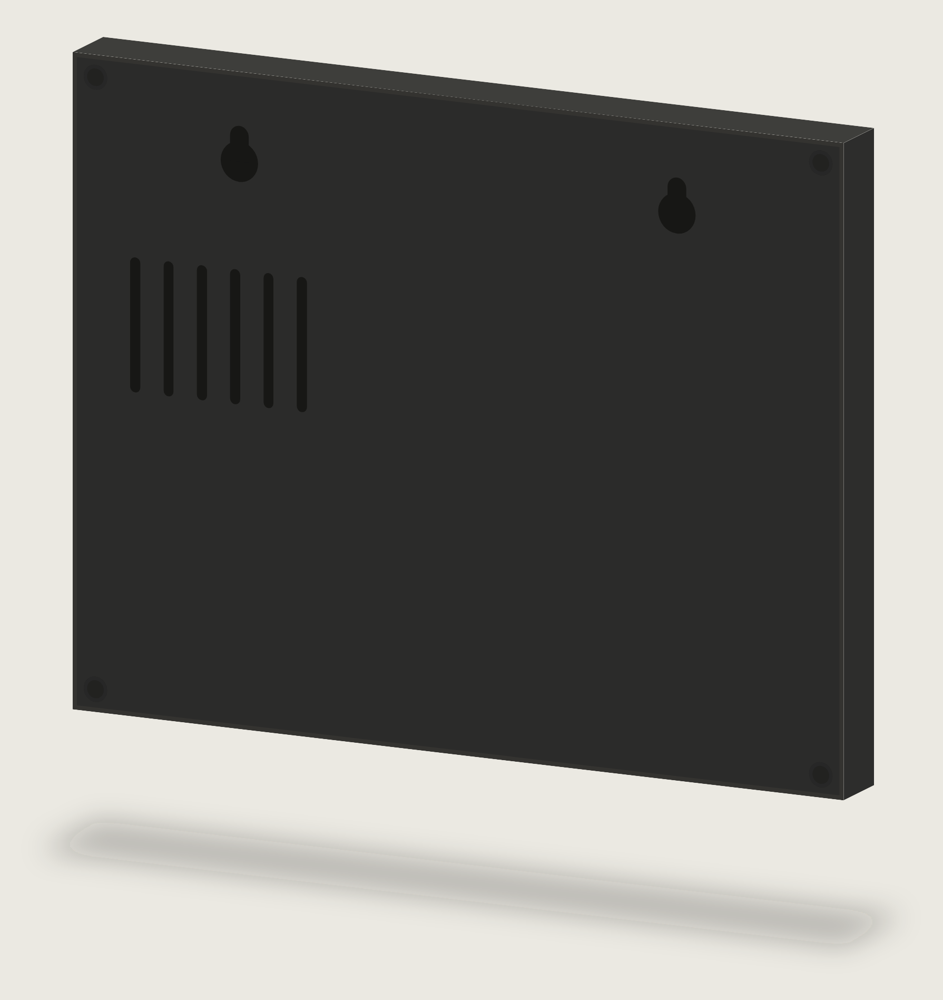

# Tablo — an e-ink panel for the desk and the wall

A 7.5″ e-ink panel for the desk (or the wall) that shows the day at a glance: the time, the weather for the next hours, deadlines, news, grades, the class schedule and the state of the home. Under the screen there are 8 mechanical buttons that control the home through Home Assistant.

The working name is **Tablo**, model **T75**. Status on 31.10.2026: the enclosure is printed and assembled, the panel runs the firmware; the service runs in Docker on a home server, the data comes from infomaster, and Home Assistant is integrated. The detailed software status is in [`README.md`](README.md).



---

## Contents

1. [What it does](#what-it-does)
2. [Screen](#screen)
3. [Buttons](#buttons)
4. [Hardware](#hardware)
5. [Custom board (in design)](#custom-board-in-design)
6. [Enclosure](#enclosure)
7. [How the software works](#how-the-software-works)
8. [Bill of materials](#bill-of-materials)
9. [Decision log](#decision-log)

---

## What it does

- **Everything at a glance:** the time and date, the weather now and for 8 hours ahead, the nearest deadlines, a news digest, fresh grades, the next classes and the state of the home.
- **8 buttons for the home.** Lights, scenes, any action in Home Assistant. Assignments change in HA without reflashing, and the icon above the button changes by itself.
- **You can see what is on.** A filled tile above a button means the device is on. After a press the tile is redrawn in a fraction of a second, without the screen flashing.
- **Paper, not a monitor.** E-ink neither glows nor flickers and reads like a printout.
- **On the wall or on the desk.** The flat enclosure hangs on two screws. For the desk there is a removable back leg at 15°, invisible from the front.
- **Always on, from USB-C.** The clock and the status line update once a minute, the data and the home as soon as they change.

---

## Screen

Good Display **GDEY075T7**: 7.5″, 800×480, black and white, landscape. The layout is designed in the screen's real pixels: body text 16 px, the clock 64 px.



### Grid

| Zone | What it shows | Details |
|---|---|---|
| **Header, left** | The time in large digits and the date on a line below | "Wed, Oct 14 · wk 7". The firmware draws the time itself, once a minute |
| **Header, weather box** | An icon, the temperature now, "feels like" | |
| **Status line** (top right corner) | Wi-Fi signal, link to the service, link to Home Assistant | Quiet while all is well. On a failure it turns into a black "offline since HH:MM" badge. The firmware draws it, not the service: the service cannot report its own failure, and only the board knows the Wi-Fi signal |
| **Forecast strip** (under the status line) | 8 columns starting with the current hour: hour, icon, temperature | See "Weather" below |
| **Deadlines** | The nearest deadlines with their dates | An urgent one is inverted |
| **Grades** | The latest grades | On a 10-point scale |
| **News** | A short digest | Prepared by infomaster |
| **Classes** | The next classes | In the evening it shows tomorrow's |
| **Home** | Temperature and humidity, how many lights are on, the 3D printer status | From Home Assistant |
| **Button row** | 8 icons without labels, exactly above the physical buttons | A filled tile means the device is on |

### Weather

- Each column of the strip: hour → a compact icon → temperature. No bars, no percentages.
- The icons are drawn with a single line and sit on one level:
  - sun — clear by day;
  - moon — clear by night;
  - cloud — cloudy;
  - cloud with 1, 2 or 3 strokes — light, moderate or heavy rain.
- The rain strength comes from Open-Meteo's precipitation: under 2.5 mm/h is one stroke, 2.5–7.6 two, more — three. Rain is drawn only if its probability is about 40% or higher; otherwise an uncertain forecast would look like a downpour.
- The weather code from the forecast adds snow, thunderstorm and fog.

### Screen refresh

- **Partial refresh** (well under a second): the clock and the status line once a minute, the button tiles after a press, the data when it changes.
- **Full refresh** (a few seconds, with flashing): at night and after a series of partial ones, to wipe the remaining ghosting. Measured timings are in [§3.4 and §10](software/06-emulator-firmware.md).

---

## Buttons

- **8 × Kailh Choc v1 Brown** — low-profile tactile switches. Tactile ones were chosen because the screen's response is not instant, and the finger should feel that the press went through.
- **20.4 mm pitch**, exactly the screen width divided by 8: each button sits right under its icon.
- **Printed "pill" keycaps, 16.4 × 12 mm**, in the enclosure colour, without legends: the labels live on the screen. They sit flush with the enclosure and sink ~2.8 mm when pressed. The first button ("all off") has a concave mark so it can be found by touch.
- **The switches are hidden under the front panel.** Only the keycaps come out, through cut-outs of the same shape with a 0.5 mm chamfer.

### Default assignments

| # | Icon | Action | Home Assistant entity |
|---|---|---|---|
| 1 | power | All lights off | an HA script |
| 2 | bulb | Ceiling light | `light.ceiling_light` (Sonoff) |
| 3 | lamp | Lamp | `light.desk_lamp` (Yeelight) |
| 4 | desk | Desk | `light.desk_light` (Tuya) |
| 5 | sparkles | Backlight | `light.desk_backlight` (Tuya) |
| 6 | hanger | Closet | `light.closet_light` (Sonoff) |
| 7 | wifi | VPN access point | `switch.vpn_ap` |
| 8 | refresh | Refresh the screen | built into the firmware |

Tuya lights are controlled through the cloud in HA, so they respond more slowly than Sonoff over the local network. Every button can also have a long press — 8 more actions.

---

## Hardware

| Component | What | Key dimensions |
|---|---|---|
| Screen | Good Display GDEY075T7, 7.5″ 800×480 b/w, 24-pin FPC | Outline 170.2 × 111.2 × 1.25 mm; active area 163.2 × 97.92 mm; 3.49 mm from the top edge to the active area; the FPC at the bottom, its centre 79.9 mm from the right edge (seen from the front), 12.5 mm wide, 24 mm long; 3.3 V |
| Board | Good Display ESP32-L(C02), ESP32-WROOM, Type-C, slide switch, reset button | 70 × 54 mm. With the header sockets desoldered the board is about 5–6 mm thick |
| Adapter | Good Display DESPI-C02 | 41 × 22 mm. Connected to the board with 8 wires instead of the P5 socket |
| Buttons | 8 × Kailh Choc v1 Brown | 13.8 mm plate cut-out, 1.3 mm plate |
| Power | USB-C into the board's own connector, 5 V | Any 5 V USB power supply from 1 A |

The screen dimensions come from the manufacturer's drawing; the board and adapter dimensions from the seller's page, checked on the real parts.

---

## Custom board (in design)

The next hardware revision replaces the ESP32-L board, the DESPI-C02 adapter and the wiring with one board of our own. Status on 09.11.2026: the schematic and the layout are in [`../pcb/`](../pcb/README.md). The schematic passes ERC; the layout is fully routed and passes DRC with the schematic parity check. Nothing is ordered or tried on hardware yet. All parts are checked against their datasheets (ESP32-S3-WROOM-1/1U v1.8, BQ2407x SLUS810N, TPS63802 SLVSEU9D, MAX17048/MAX17049, GDEY075T7 specification §5 and §11).

### Goals

- **Better Wi-Fi:** a module with an external antenna, placed away from the screen and the board.
- **More memory:** 8 MB of PSRAM. The current board has ~48 KB of free heap while connected, and frame buffers do not fit comfortably.
- **No wiring:** the screen FPC and the switches go straight into the board.
- **A battery:** the board can run without the cable, from days to months depending on the power mode.

### Power modes

One board for all three; the difference is only in the firmware, and it is done in this order.

| Mode | When | How it works | Battery life (rough, ~2000 mAh) |
|---|---|---|---|
| **A** | On USB | As now: always connected, the service pushes frames, presses answer in a fraction of a second | — |
| **B** | On battery, stays responsive | Connected with Wi-Fi power save; everything else as in A | ~2–3 days |
| **C** | On battery, long life | Deep sleep. Wakes every minute without Wi-Fi to redraw the clock; every 10–15 min connects and pulls the frame. A button wakes the board: it flips the tile at once and sends the press after connecting (1–2 s). Home changes made elsewhere show up with a delay | ~2.5–3 months |

The board knows its power source from the charger's power-good signal and picks the mode itself: plugging in the cable wakes it and switches to A. Mode C needs a protocol change (the board pulls frames instead of the service pushing them) and must keep the last frame in the screen controller's memory across sleep for partial refresh — to be checked on the real panel.

### Block diagram

```
USB-C ─ ESD ─ VBUS ──▶ BQ24074 (charger with power path)
                         ├── BAT ── LiPo 3.7 V, ~2000 mAh (leads soldered to pads)
                         │           └── MAX17048 (fuel gauge, I²C)
                         └── OUT ──▶ TPS63802 (buck-boost, 3.3 V)
                                       ├── ESP32-S3-WROOM-1U-N16R8 ── U.FL ── adhesive FPC antenna
                                       ├── 32.768 kHz crystal
                                       └── load switch ── e-paper booster (as on DESPI-C02) ── 24-pin FPC connector
8 × Choc soldered to the board ──▶ RTC GPIOs (can wake the chip from deep sleep)
```

### Parts

| Block | Part | Notes |
|---|---|---|
| MCU | ESP32-S3-WROOM-1U-N16R8 | 16 MB flash, 8 MB octal PSRAM, U.FL; native USB, so no USB-UART chip and no reset through DTR/RTS. EN: 10 kΩ to 3.3 V and 1 µF to ground, as the datasheet recommends |
| Antenna | 2.4 GHz adhesive FPC antenna with a U.FL lead | On the inner wall at the top edge, as far from the board and the battery as possible |
| Clock | 32.768 kHz crystal | Keeps time in deep sleep; the internal RC oscillator drifts too much for a minute clock |
| Charger | BQ24074 (VQFN-16) | Runs the load from USB while charging; OUT is regulated to 4.4 V. ISET 1.0 kΩ → ~0.9 A charge (K_ISET 890 AΩ, 0.45C). ILIM 1.1 kΩ (the minimum) → ~1.46 A input limit with EN2 high, EN1 low, so any 5 V / 2 A supply works. CE to ground, TMR and ITERM open (default timers, 10% termination). TS on a fixed 10 kΩ: no battery temperature sensing unless a cell with an NTC is used. PGOOD and CHG are open drain, pulled up to 3.3 V. IN 10 µF, OUT and BAT 10 µF |
| Regulator | TPS63802 (VSON-10, 2 × 3 mm) | Buck-boost: a steady 3.3 V over the whole battery range, 11 µA quiescent. 0.47 µH inductor (e.g. XFL4015-471ME), 10 µF in, 22 µF out; divider 511 kΩ / 91 kΩ (V_FB 0.5 V); MODE low (power save), EN high, PG not used |
| Fuel gauge | MAX17048 (TDFN-8, 2 × 2 mm) | Battery percentage for the status line; its alert pin wakes the board on low battery. VDD and CELL on the battery, 0.1 µF on VDD; CTG and QSTRT to ground; I²C address 0x36, 4.7 kΩ pull-ups; ALRT is open drain, 100 kΩ pull-up |
| Power switch | Slide switch on the regulator's EN | Off: the regulator stops, only the charger and the fuel gauge stay on the battery (for storage and shipping) |
| Battery | Flat LiPo 604060, 6 × 40 × 60 mm, ~2000 mAh | Light and small; enough for months in mode C. 18650 cells do not fit the 17 mm enclosure |
| Screen power | The GDEY075T7 reference circuit (spec §11), a 24-pin 0.5 mm top-contact FPC connector (Hirose FH12A: the FPC reaches it with its contacts facing up), a load switch | Booster: 10 µH / 1 A inductor, Si1308EDL MOSFET with 1 MΩ gate pull-down, 3 × MBR0530, **RESE 0.47 Ω**; 4.7 µF / 25 V on the booster node, PREVGH, PREVGL, VSHR, VSH1 and VSL, 1 µF / 25 V on VCI, VDD and VCOM; BS to ground (4-wire SPI); VDDIO and VCI on 3.3 V (2.5–3.6 V, ~8 mA while refreshing); NC, VPP, TSCL and TSDA open. The load switch can cut the screen off completely; in mode C the screen stays powered in its own sleep to keep the last frame |
| USB | USB-C receptacle, 5.1 kΩ CC pull-downs, ESD protection | On the right end, where the connector is now |
| Switches | Kailh Choc v1 soldered straight into the board | No sockets: thinner and cheaper; the switches clip into the plate first, then the board is soldered on |
| Debug | BOOT and RESET buttons; test pads for 3.3 V, GND, VBAT, VSYS and UART0 | No LEDs: they would not be seen inside the enclosure |

### Pin map

| Function | GPIO | Why |
|---|---|---|
| Buttons 1–8 | 1, 2, 14, 4, 5, 6, 7, 8 | RTC GPIOs: deep-sleep wake on any button (ext1, any low). 100 kΩ pull-ups to 3.3 V. Button 3 is on GPIO14 because GPIO3 is a strapping pin |
| Fuel gauge I²C (SDA, SCL) | 9, 10 | |
| USB present (charger PGOOD) | 11 | Wakes the board when the cable is plugged in |
| Charging (charger CHG) | 12 | |
| Low battery (fuel gauge ALRT) | 13 | Wakes the board |
| Screen SCK, MOSI, CS, DC, RST, BUSY | 40, 41, 42, 39, 38, 47 | Do not need to wake the chip, so they use the non-RTC pins |
| Screen power (load switch) | 48 | |
| 32 kHz crystal | 15, 16 | Fixed by the chip |
| USB D−, D+ | 19, 20 | Fixed by the chip |
| UART0 TX, RX | 43, 44 | Test pads only |
| BOOT | 0 | Test pad or a small button |
| Not used | 3, 45, 46 (strapping), 35–37 (octal PSRAM) | |
| Spare | 17, 18, 21 | |

### Placement

The board outline comes from [`../cad/tablo.scad`](../cad/tablo.scad) and fits the current 17 mm depth; the enclosure has a `board = "custom"` variant for it (see [`../cad/README.md`](../cad/README.md#for-the-custom-board)). Coordinates below are the enclosure's: seen from the back, x to the right, y up from the bottom edge.

- **One board, 173.5 × 41.6 mm** (x 2.5–176, y 8.7–50.3), 4 layers: signals on the outer layers, solid planes: GND on In1, 3.3 V on In2. It sits under the switch plate like a keyboard PCB, 10.1 mm from the front: the switches clip into the plate, their pins are soldered into the board, and the board hangs on them, with no screws. Seven posts on the cover keep it there: three between the keys and four along the top edge, behind the screen. A stop on the cover behind the far end takes the force of plugging in USB-C; pulling the plug out, the board rests against the side wall. The lower part is under the keys, the upper part reaches behind the bottom edge of the screen.
- **All the parts are on one side**, the one facing the cover; the switches go in from the other side, with their pins up (towards the screen) so that the plate screws under the keys stay clear. That side has 2.8 mm to the cover, so the cover has 1 mm pockets over the 3.2 mm module and the USB-C receptacle.
- **The screen FPC** goes back through a 14 × 2 mm slot right under the panel's bottom edge and into the connector next to it on the parts side.
- **The battery** lies on the cover behind the screen, above the board (x 60–120, y 52–92), in a fence printed on the cover. Its leads are soldered to two pads on the board, under the middle of the battery (x ≈ 102–106): a connector would not fit the depth.
- **USB-C and the power switch** are on the left end (seen from the back, the right end seen from the front): USB-C 36 mm from the bottom, the switch 19 mm. The USB-C opening reaches the cover edge, because the receptacle sits close to it.
- **The antenna** is a sticker on the inside of the cover near the top edge, away from the battery and the board; its cable goes to the module's U.FL.

### Steps

1. Parts and pin map — done.
2. Schematic in KiCad, project in `pcb/` — first draft done, ERC clean.
3. Layout together with the enclosure update — layout done (`pcb/tablo.kicad_pcb`, fully routed; enclosure `board = "custom"`); next a review of the power loops by eye.
4. Order and bring-up: power and charging first, then the screen, Wi-Fi, buttons.
5. Firmware on the S3 in mode A.
6. Mode B: battery operation, the charge level in the status line.
7. Mode C: deep sleep and frame pulling.

---

## Enclosure

A parametric OpenSCAD model with all dimensions in one file: [`../cad/tablo.scad`](../cad/tablo.scad). Detailed printing and assembly instructions: [`../cad/README.md`](../cad/README.md).



### Size and look

- **185 × 146 × 17 mm**, flat, dark plastic.
- **Chamfers:** 1.5 mm on the front edge, 1 mm on the cover edge, 0.5 mm on the key cut-outs.
- **Right end** (seen from the front): a cut-out for the board's Type-C and a slot to the power switch.
- **Back:** two holes for wall mounting, 4 countersunk screws, ventilation slots over the board.

| On the wall | On the desk | Back |
|---|---|---|
|  |  |  |

### Printed parts

The files are in `cad/stl/esp32l/` for the current ESP32-L kit and in `cad/stl/custom/` for the custom board; only the front and the back cover differ (on the custom board the cover has the battery fence and the board posts instead of the clips and the adapter pad).

| Part | File | Print orientation | Notes |
|---|---|---|---|
| Key test | `tablo-key_test.stl` | as is | **Print first.** A piece of wall and plate for 2 keys, plus one hole for a heat-set insert |
| Front | `tablo-front.stl` | face down | Screen window, panel guides, switch pockets, bosses, port cut-outs |
| Switch plate | `tablo-key_plate.stl` | flat | 1.3 mm, 100% infill. A separate part because the top of a switch (15 × 15 mm) does not pass through the keycap cut-out |
| Back cover | `tablo-back.stl` | outside down | Wall holes, board clips, the adapter pad, ventilation |
| Back leg | `tablo-leg.stl` | bar down | For the desk, 15° tilt |
| Keycaps | `tablo-keycap.stl` × 7, `tablo-keycap_dimple.stl` × 1 | top down | 0.12 mm layers |

PLA or PETG, 0.2 mm layers, 3 perimeters, no supports.

### Inside

- **The screen** is stuck with thin double-sided tape to the window frame and sits between the guides. The FPC bends backwards, with 3 mm left under the screen for the bend.
- **The board** snaps into the back cover's clips, components facing the cover. The Type-C edge is pressed against the right wall, so the cable plugs straight into the board. A stop on the opposite side takes the force of plugging in the cable. The board's mounting holes are not used.
- **The adapter** is taped to the cover's pad, next to where the FPC comes out.
- **The switches** snap into the plate, and the plate is screwed from the inside into the block under the keys.

### Fasteners

| What | How many | Where |
|---|---|---|
| M2.5 × 3 × 4 heat-set insert (length 3, diameter 4) | 7 | 4 in the corner bosses, 3 in the block under the keys (3.6 mm hole) |
| M2.5 × 8 countersunk screw, DIN 965 | 4 | Back cover |
| M2.5 × 6 cylinder-head Torx screw | 3 | Switch plate. The plate has 1.7 mm pads so the screw ends right in the insert |
| Two Ø4 wood screws, head up to 8.5 mm | 2 | Into the wall or into the leg (the heads stick out 2.8 mm) |

### Wall and desk

- **Wall:** two screws in the wall; the enclosure goes onto them by its holes and slides down. A cable with a right-angle plug leaves the right end downwards.
- **Desk:** a back leg like a photo frame's. The same two screws go into its bar, sticking out 2.8 mm, the heads enter the enclosure's holes, and the leg slides up into the lock. The enclosure stands on its bottom end at 15° and leans on the leg with its weight. Button presses also push back into the leg. The leg is not visible from the front.

### What to measure before printing the enclosure

1. **Key test:** the switch snaps into the plate without play (`choc_cut`). The keycap sits flush with the front and travels the full stroke (`stem_top_rest`, `house_above_plate`). The keycap sits tight on the stems (`stem_w`, `stem_dx`). The insert melts in straight (`insert_d`).
2. **The board** after desoldering the sockets: the tallest component (`comp_h`), the centre of the Type-C and the switch from the bottom edge (`usbc_from_bottom`, `switch_from_bottom`).
3. **The screen:** the FPC at the bottom, its centre 79.9 mm from the right edge (`fpc_from_right`).

To rebuild a part:

```bash
openscad --backend=manifold -o cad/stl/esp32l/tablo-front.stl -D 'part="front"' -D 'board="esp32l"' cad/tablo.scad
```

---

## How the software works

A smart server and a simple device. All the heavy work is done by a separate service on a home server next to Home Assistant. The device only shows the finished picture, draws the clock and the status line itself and passes on button presses.

> The detailed software design (protocol, data sources, HA integration, emulator, work plan) is in [`README.md`](README.md). Where it disagrees with this section, it wins.

```
Open-Meteo ──┐
infomaster ──┼──▶  Tablo service  ──────┬──── 800×480 frame ────▶ Tablo (ESP32-L)
             │    (home server)         │                         · clock, status line
             │         ▲    │           └◀─── button presses ───  · 8 buttons
             │         │    ▼
             └──── Home Assistant (lights, sensors)
```

- **The service** collects and caches the data on schedules (weather, deadlines, news, grades, classes) and takes the home from Home Assistant as it changes. It draws the 800×480 black-and-white frame with Pillow; the frame can be opened in a browser for debugging. It keeps the button assignments and the tile states, receives a press ("button 3, short"), runs the action in HA and sends back the updated frame.
- **The firmware** receives the frame over the network and shows it with a partial refresh (GxEPD2, which supports the GDEY075T7). It draws the clock (time from NTP) and the status line itself once a minute, polls the buttons with debounce (short and long press), sends them to the service and redraws the tile at once. It runs constantly from USB, with no sleep.

---

## Bill of materials

| What | Notes |
|---|---|
| Screen GDEY075T7 | Good Display |
| Board ESP32-L(C02) + adapter DESPI-C02 | [buy-lcd.com](https://buy-lcd.com/products/esp32-arduino-platform-e-paper-panel-driver-board-type-c-interface-eink-development-kit-esp32-lc02) |
| Kailh Choc v1 Brown, 8 (+2 spare) | |
| M2.5 × 3 × 4 heat-set inserts, M2.5 × 8 countersunk and M2.5 × 6 Torx screws | See "Fasteners" |
| Thin double-sided tape, 30 AWG wire, a USB-C cable with a right-angle plug | |
| PLA or PETG filament | |

---

## Decision log

| When | Decision | Why |
|---|---|---|
| 14.10 | A custom e-ink panel instead of reflashing an existing badge | The badge has Secure Boot enabled and cannot be reflashed |
| 14.10 | Layout sketch: a header, a forecast strip, 2 + 3 columns, buttons at the bottom | The owner's sketch |
| 14.10 | 10.3″ → 10.2″ GDEM102T91 → **7.5″ GDEY075T7 in landscape** | Price: a 10.3″ panel costs several times more. Colour panels were rejected — they have no partial refresh |
| 14.10 | A black-and-white screen | Partial refresh in a fraction of a second; without it the buttons would respond in half a minute |
| 14.10 | **8 buttons, only icons on screen**, a filled tile = on | Word labels do not fit on 7.5″ |
| 14.10 | Choc Brown switches, pill keycaps, a mark on "all off" | Low profile, tactile feedback |
| 14.10 | **USB power**, a battery postponed | It would need a different board and a sleep mode; on USB it runs all the time and stays responsive |
| 14.10 | A clock in the header, the time large on the left | The device is always on |
| 14.10 | Weather: 8 hours, compact icons, 1–3 rain strokes | Percentages and bars read worse |
| 14.10 | Grades on a 10-point scale, without a frame | The owner's decision |
| 14.10 | A separate service on a home server | Heavy data and layout are not for an ESP32; the layout changes without reflashing |
| 15.10 | A wedge enclosure → **a flat enclosure** | It can hang on the wall |
| 15.10 | A light stand → **a back leg on the wall holes** | The stand looked foreign; the leg is invisible from the front |
| 15.10 | The connector **on the side**, into the board itself | The switches sit under the bottom end, and a connector there would add thickness |
| 15.10 | The status line above the forecast, drawn by the firmware | The service cannot report its own failure, and only the board knows the Wi-Fi signal |
| 15.10 | M2.5 heat-set inserts | More reliable than self-tapping screws in plastic |
| 30.10 | Keys **flush with the enclosure**, sinking when pressed; enclosure 15 → 17 mm | The owner's decision. The switches had to go 2 mm deeper, and the pins with wires lacked room to the cover |
| 09.11 | **A custom board** instead of ESP32-L + DESPI-C02, ready for a battery from the start; power modes A → B → C in the firmware step by step | Weak Wi-Fi, little free heap, the wiring; the battery postponed on 14.10 needed exactly a different board |
| 09.11 | **One long board under the keys** instead of a main board plus a key board | No wires at all; the FPC and the USB-C land where they already are |
| 09.11 | ESP32-S3 with PSRAM rather than ESP32-C6 | Memory and native USB; Wi-Fi 6 power saving on the C6 depends on the router |
| 09.11 | U.FL module with an adhesive antenna at the top edge | The antenna away from the screen, the board and the battery |
| 09.11 | BQ24074 + TPS63802 + MAX17048 rather than TP4056 + LDO | Runs from USB while charging, a steady 3.3 V down to an empty battery, low quiescent current for deep sleep |
| 09.11 | **4-layer board, all parts on the side facing the cover**; the switches go in from the other side with their pins up | Planes for GND and 3.3 V; one-sided assembly; the plate screws under the keys stay clear |
| 09.11 | **The FPC goes back through a slot** in the board to a connector on the parts side | All the parts stay on one side; the panel's FPC is long enough for the bend |
| 09.11 | **The battery lies on the cover**, its leads soldered to the board; the board hangs on the switches | No room for a connector in 2.8 mm; no screws needed for the board |
| 09.11 | **Switches soldered** into the board, no hot-swap sockets; **a 2000 mAh LiPo** instead of 4000 mAh | The owner's decision: thinner and simpler; 2000 mAh still lasts months in mode C and is half the size |
