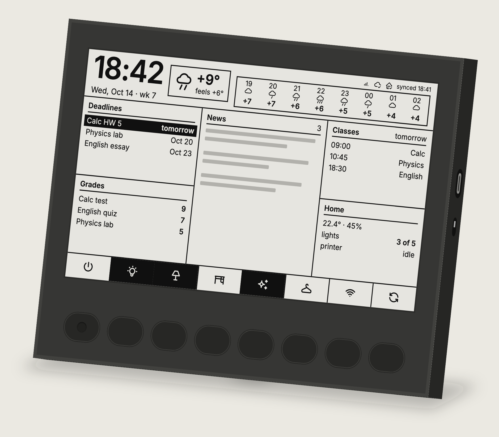
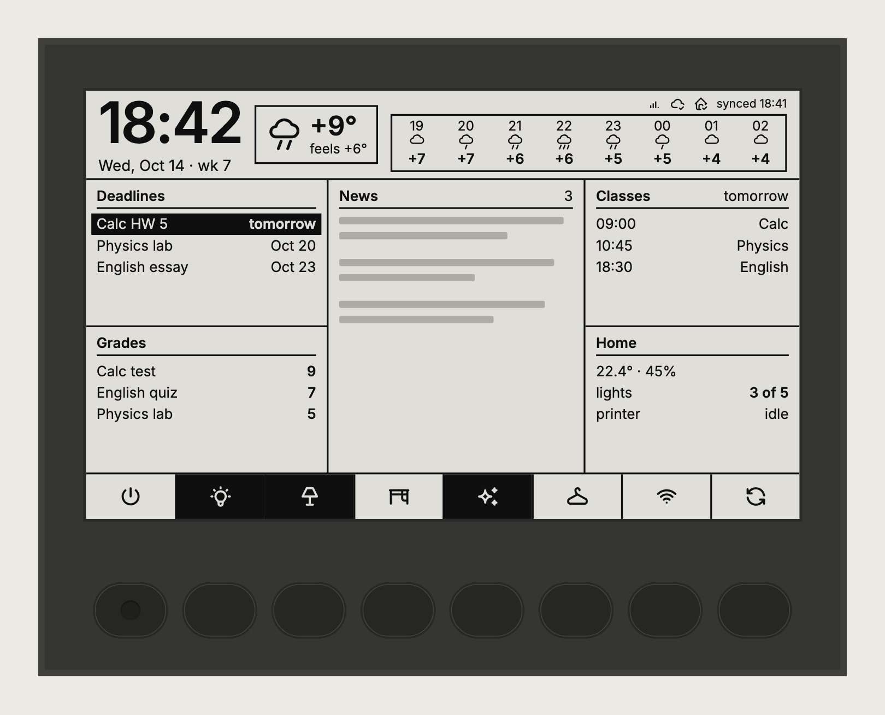
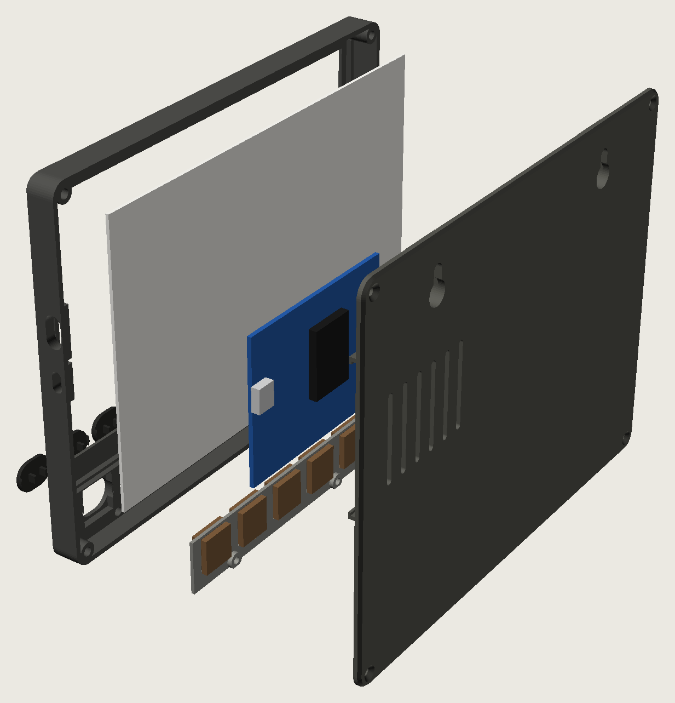
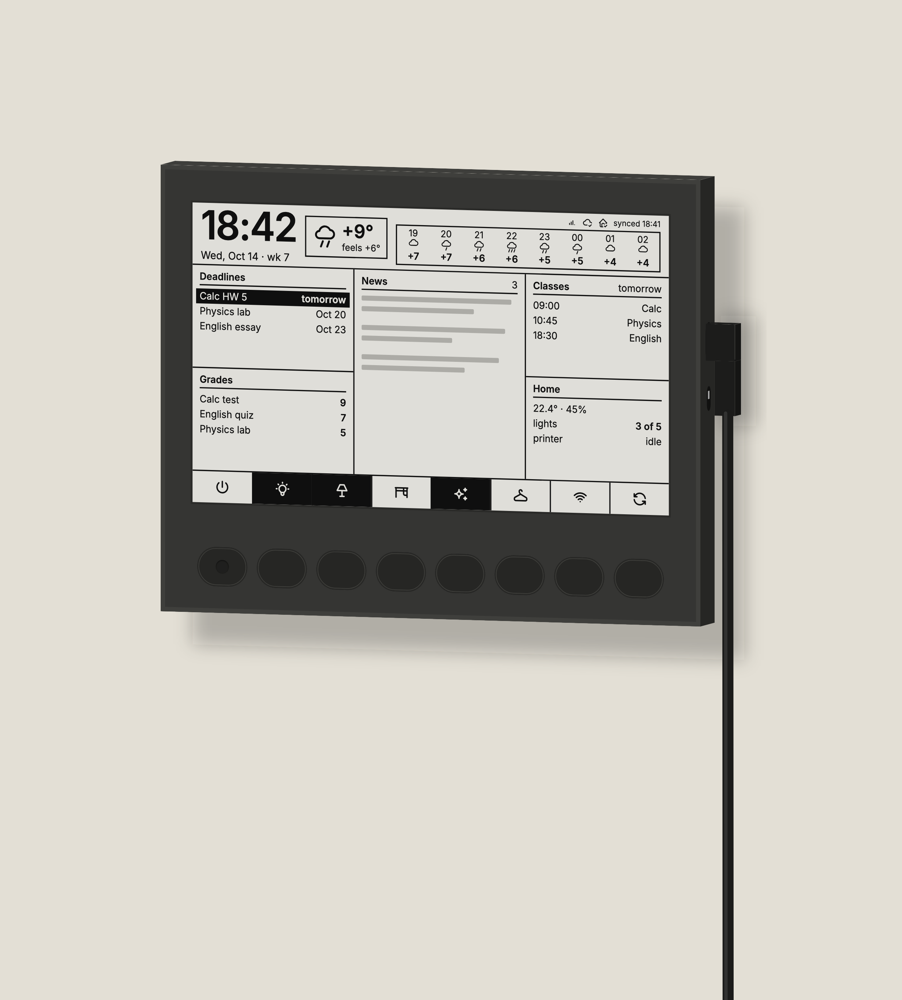
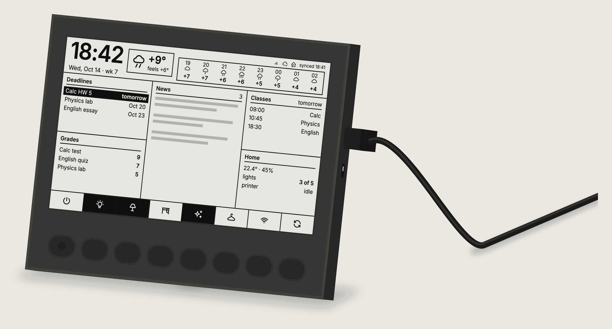
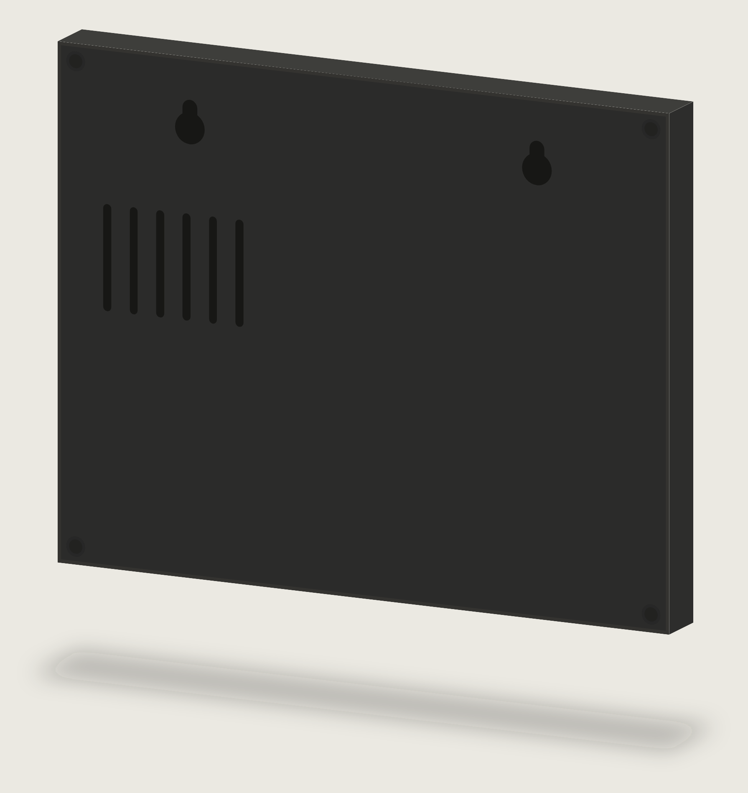

# Tablo — e-ink панель для стола и стены

Настольная (или настенная) e-ink панель 7.5″, которая одним взглядом показывает день: время, погоду на ближайшие часы, дедлайны, новости, оценки, расписание пар и состояние дома. Под экраном — 8 механических кнопок для управления домом через Home Assistant.

Рабочее название — **Tablo**, модель **T75**. Статус на 15.10.2026: дизайн экрана и корпуса готов, модель для печати готова, крепёж куплен. Прошивки и сервиса ещё нет.



---

## Содержание

1. [Что умеет](#что-умеет)
2. [Экран](#экран)
3. [Кнопки](#кнопки)
4. [Железо](#железо)
5. [Корпус](#корпус)
6. [Как устроен софт](#как-устроен-софт)
7. [Данные](#данные)
8. [Закупка](#закупка)
9. [Файлы проекта](#файлы-проекта)
10. [Что дальше](#что-дальше)
11. [История решений](#история-решений)

---

## Что умеет

- **Всё за один взгляд:** время и дата, погода сейчас и на 8 часов вперёд, ближайшие дедлайны, выжимка новостей, свежие оценки, ближайшие пары и состояние дома.
- **8 кнопок для дома.** Свет, сцены, любые действия в Home Assistant. Назначения меняются в HA, без перепрошивки, значок над кнопкой меняется сам.
- **Видно, что включено.** Залитая плашка над кнопкой — устройство включено. После нажатия плашка перерисовывается примерно за 0,3 с, без мигания экрана.
- **Бумага, а не монитор.** E-ink не светит и не мерцает, читается как распечатка.
- **На стену или на стол.** Плоский корпус вешается на два шурупа. Для стола есть съёмная задняя ножка под 15°, спереди её не видно.
- **Работает постоянно от USB-C.** Часы и строка статуса обновляются раз в минуту, данные и дом — сразу при изменении.

---

## Экран

Good Display **GDEY075T7**: 7.5″, 800×480, чёрно-белый, горизонтально. Раскладка сверстана в настоящих пикселях экрана: основной текст 16 px, часы 64 px.



### Сетка

| Зона | Что показывает | Детали |
|---|---|---|
| **Шапка, слева** | Время крупно и дату строкой под ним | «Wed, Oct 14 · wk 7». Время рисует сама прошивка, раз в минуту |
| **Шапка, бокс погоды** | Значок, температуру сейчас, «ощущается как» | |
| **Строка статуса** (правый верхний угол) | Сигнал Wi-Fi, связь с сервисом, связь с Home Assistant, время последней синхронизации | Пока всё в порядке, строка тихая. При сбое она превращается в чёрную плашку «offline since HH:MM». Рисует прошивка, а не сервис: сервис не может сообщить о собственном падении, а уровень Wi-Fi знает только плата |
| **Полоса прогноза** (под строкой статуса) | 8 колонок, начиная с текущего часа: час, значок, температура | См. «Погода» ниже |
| **Deadlines** | 3 ближайших дедлайна с датой | Срочный (завтра) выделен инверсией |
| **Grades** | 3 последние оценки | По 10-балльной шкале, без выделения |
| **News** | Короткая выжимка, 3 новости | Делает LLM на сервисе |
| **Classes** | 3 ближайшие пары | Вечером показывает пары на завтра |
| **Home** | Температура и влажность, сколько горит света, статус 3D-принтера | Из Home Assistant |
| **Ряд кнопок** | 8 значков без подписей, точно над физическими кнопками | Залитая плашка — устройство включено |

### Погода

- В каждой колонке полосы: час → компактный значок → температура. Столбиков и процентов нет.
- Значки нарисованы одной линией и стоят на одном уровне:
  - солнце — ясно днём;
  - луна — ясно ночью;
  - облако — облачно;
  - облако с 1, 2 или 3 штрихами — слабый, умеренный или сильный дождь.
- Сила дождя считается по количеству осадков из Open-Meteo: меньше 2,5 мм/ч — один штрих, 2,5–7,6 — два, больше — три. Дождь рисуется, только если его вероятность примерно 40% и выше, иначе неуверенный прогноз выглядел бы как ливень.
- Расширяется кодом погоды из прогноза: снег, гроза, туман.

### Обновление экрана

- **Частичное обновление** (0,3 с): часы и строка статуса раз в минуту, плашки кнопок после нажатия, данные при изменении.
- **Полное обновление** (3 с, с миганием): раз в час или ночью, чтобы стереть остаточные следы изображения.

---

## Кнопки

- **8 × Kailh Choc v1 Brown** — низкопрофильные тактильные свитчи. Тактильные выбраны потому, что отклик экрана не мгновенный, и палец должен сам почувствовать, что нажатие прошло.
- **Шаг 20,4 мм**, ровно ширина экрана, поделённая на 8: каждая кнопка точно под своим значком.
- **Колпачки печатные, «таблетки» 16,4 × 12 мм**, в цвет корпуса, без надписей: подписи живут на экране. Стоят вровень с корпусом и при нажатии утапливаются на ~2,8 мм. У первой кнопки («всё выкл») вогнутая метка, чтобы находить её на ощупь.
- **Свитчи спрятаны под лицевую панель.** Наружу выходят только колпачки через вырезы той же формы с фаской 0,5 мм.

### Назначения по умолчанию

| # | Значок | Действие | Сущность Home Assistant |
|---|---|---|---|
| 1 | power | Выключить весь свет | скрипт в HA (сделать) |
| 2 | bulb | Потолочный свет | `light.ceiling_light` (Sonoff) |
| 3 | lamp | Лампа | `light.desk_lamp` (Yeelight) |
| 4 | desk | Стол | `light.desk_light` (Tuya) |
| 5 | sparkles | Подсветка | `light.desk_backlight` (Tuya) |
| 6 | hanger | Шкаф | `light.closet_light` (Sonoff) |
| 7 | wifi | VPN-точка доступа | `switch.vpn_ap` |
| 8 | refresh | Обновить экран | на сервисе |

Свет Tuya в HA управляется через облако, поэтому откликается медленнее, чем Sonoff по локальной сети. При желании на каждую кнопку можно повесить и долгое нажатие — это ещё 8 действий.

---

## Железо

| Компонент | Что | Ключевые размеры |
|---|---|---|
| Экран | Good Display GDEY075T7, 7.5″ 800×480 ч/б, 24-pin FPC | Контур 170,2 × 111,2 × 1,25 мм; рабочая область 163,2 × 97,92 мм; от верхнего края до рабочей области 3,49 мм; шлейф снизу, его центр в 79,9 мм от правого края (если смотреть спереди), ширина 12,5 мм, длина 24 мм; частичное обновление 0,3 с, полное 3 с; 3,3 В |
| Плата | Good Display ESP32-L(C02), ESP32-WROOM, Type-C, ползунковый выключатель, кнопка сброса | 70 × 54 мм. Гнёзда-разъёмы выпаиваются, плата становится около 5–6 мм |
| Переходник | Good Display DESPI-C02 | 41 × 22 мм. Соединяется с платой 8 проводами вместо гнезда P5 |
| Кнопки | 8 × Kailh Choc v1 Brown | Вырез в пластине 13,8 мм, пластина 1,3 мм |
| Питание | USB-C в разъём самой платы, 5 В | Любой блок питания USB на 5 В от 1 А |

Размеры экрана взяты с чертежа производителя. Размеры платы и переходника — со страницы продавца. Положение Type-C и выключателя на плате оценено по фото и требует замера.

---

## Корпус

Параметрическая модель в OpenSCAD, все размеры в одном файле: [`tablo-cad/tablo.scad`](tablo-cad/tablo.scad). Подробная инструкция по печати и сборке: [`tablo-cad/README.md`](tablo-cad/README.md).



### Габариты и внешний вид

- **185 × 146 × 17 мм**, плоский, тёмный пластик.
- **Фаски:** по переднему краю 1,5 мм, по краю крышки 1 мм, на вырезах клавиш 0,5 мм.
- **Правый торец** (если смотреть спереди): вырез под Type-C платы и прорезь к выключателю питания.
- **Сзади:** два отверстия для крепления на стену, 4 потайных винта, вентиляционные прорези над платой.

| На стене | На столе | Сзади |
|---|---|---|
|  |  |  |

### Печатные детали

| Деталь | Файл | Ориентация при печати | Заметки |
|---|---|---|---|
| Пробник клавиш | `stl/tablo-key_test.stl` | как есть | **Печатать первым.** Кусок стенки и пластины на 2 клавиши, плюс одно отверстие под закладную |
| Передняя часть | `stl/tablo-front.stl` | лицом вниз | Окно экрана, направляющие панели, карманы под свитчи, бобышки, вырезы портов |
| Пластина свитчей | `stl/tablo-key_plate.stl` | плашмя | 1,3 мм, заполнение 100%. Отдельная деталь, потому что верх свитча (15 × 15 мм) не пролезает в вырез под колпачок |
| Задняя крышка | `stl/tablo-back.stl` | наружной стороной вниз | Отверстия для стены, клипсы платы, площадка переходника, вентиляция |
| Задняя ножка | `stl/tablo-leg.stl` | планкой вниз | Для стола, наклон 15° |
| Колпачки | `stl/tablo-keycap.stl` × 7, `stl/tablo-keycap_dimple.stl` × 1 | верхом вниз | Слой 0,12 мм |

PLA или PETG, слой 0,2 мм, 3 периметра, без поддержек.

### Внутри

- **Экран** приклеен тонким двусторонним скотчем к рамке окна и уложен между направляющими. Шлейф загибается назад, под экраном оставлено 3 мм на изгиб.
- **Плата** защёлкивается в клипсы задней крышки компонентами к крышке. Край с Type-C прижат к правой стенке, так что кабель втыкается прямо в плату. Упор с противоположной стороны принимает усилие, когда втыкаешь кабель. Отверстия платы не используются, потому что их положение неизвестно.
- **Переходник** приклеен на скотч на площадку крышки, рядом с выходом шлейфа.
- **Свитчи** защёлкиваются в пластину, а пластина прикручивается изнутри в блок под клавишами.

### Крепёж (куплен)

| Что | Сколько | Куда |
|---|---|---|
| Закладная гайка M2.5 × 3 × 4 (длина 3, диаметр 4) | 7 из 20 | 4 в угловые бобышки, 3 в блок под клавишами (отверстие 3,6 мм) |
| Винт M2.5 × 8, потай, DIN 965 | 4 из 25 | Задняя крышка |
| Винт M2.5 × 6, цилиндрическая головка, Torx | 3 из 10 | Пластина свитчей. На пластине площадки 1,7 мм, чтобы винт закончился ровно в закладной |
| Два шурупа Ø4, головка до 8,5 мм | 2 | На стену или в ножку (головки торчат на 2,8 мм) |

### Стена и стол

- **Стена:** два шурупа в стену, корпус надевается отверстиями и опускается вниз. Кабель с Г-образной вилкой уходит с правого торца вниз.
- **Стол:** задняя ножка как у фоторамки. Те же два шурупа вкручиваются в её планку с выступом 2,8 мм, головки входят в отверстия корпуса, ножка сдвигается вверх в замок. Корпус стоит на нижнем торце под 15° и давит на ножку своим весом. Нажатия кнопок тоже давят назад, в ножку. Спереди ножку не видно.

### Что измерить перед печатью корпуса

1. **Пробник:** свитч защёлкивается в пластине и не болтается (`choc_cut`). Колпачок стоит вровень с лицевой стороной и проходит полный ход (`stem_top_rest`, `house_above_plate`). Колпачок плотно сидит на ножках (`stem_w`, `stem_dx`). Закладная вплавляется ровно (`insert_d`).
2. **Плата** после выпаивания разъёмов: самая высокая деталь (`comp_h`), центр Type-C и выключателя от нижнего края (`usbc_from_bottom`, `switch_from_bottom`).
3. **Экран:** шлейф снизу, центр в 79,9 мм от правого края (`fpc_from_right`).

---

## Как устроен софт

Умный сервер и простое устройство. Всё тяжёлое делает отдельный сервис на домашнем сервере рядом с Home Assistant. Устройство только показывает готовую картинку, само рисует часы и строку статуса и передаёт нажатия кнопок.

> Подробный проект софта (протокол, источники данных, интеграция HA, эмулятор, план работ) — в [`tablo-software.md`](tablo-software.md). Где он расходится с этим разделом, верен он.

```
Open-Meteo ─┐
Календарь ──┤                         ┌──── кадр 800×480 ────▶ Tablo (ESP32-L)
Портал вуза ┼──▶  Сервис Tablo  ──────┤                         · часы, строка статуса
RSS + LLM ──┘    (домашний сервер)    └◀─── нажатия кнопок ───  · 8 кнопок
                     ▲    │
                     │    ▼
                  Home Assistant (свет, датчики)
```

### Сервис (на домашнем сервере, рядом с HA)

- **Собирает и кэширует данные** по расписанию: погода, календарь, оценки, новости. Дом — из API Home Assistant, сразу при изменении.
- **Рисует кадр 800×480 в ч/б.** Раскладка вёрстается как HTML и снимается в PNG (или сразу в битовую карту). Кадр можно открыть в браузере для отладки.
- **Хранит назначения кнопок** и состояние плашек. Получает нажатие («кнопка 3, коротко»), вызывает нужное действие в HA и отдаёт обновлённую полосу кнопок.

### Прошивка (ESP32-L)

- Скачивает кадр по сети и выводит его через частичное обновление (например, библиотекой GxEPD2, в которой есть GDEY075T7).
- **Сама рисует** часы (время по NTP) и строку статуса раз в минуту, тоже частичным обновлением.
- **Полное обновление** раз в час или ночью.
- **Кнопки** опрашивает с подавлением дребезга: короткое и долгое нажатие, отправка сервису, быстрая перерисовка полосы кнопок.
- Питание постоянное от USB, без сна.

---

## Данные

| Блок | Источник | Статус |
|---|---|---|
| Погода | Open-Meteo: почасовая температура, осадки, вероятность осадков, код погоды. Бесплатно, без ключа | Готово к использованию |
| Пары | Календарь Google (iCal) | Нужна ссылка на календарь |
| Дедлайны | Портал вуза, Todoist, Google Tasks или HA | Выбрать источник |
| Оценки | Портал вуза, по 10-балльной шкале | **Самая неизвестная часть:** нужен API или парсинг |
| Новости | RSS и выжимка LLM | Выбрать ленты и модель |
| Дом | API Home Assistant: температура и влажность (датчик Tuya), свет, принтер (Klipper) | Сущности известны |

---

## Закупка

| Что | Статус | Цена |
|---|---|---|
| Экран GDEY075T7 | **Купить** | Уточнить |
| Плата ESP32-L(C02) + DESPI-C02 ([buy-lcd.com](https://buy-lcd.com/products/esp32-arduino-platform-e-paper-panel-driver-board-type-c-interface-eink-development-kit-esp32-lc02)) | **Купить** | Уточнить |
| Kailh Choc v1 Brown, 10 шт ([AliExpress](https://aliexpress.ru/item/1005005970877769.html)) | Уточнить, заказаны ли | 582 ₽ |
| Закладные M2.5 × 3 × 4, 20 шт | Куплены | 200 ₽ |
| Винты M2.5 × 8 потай, 25 шт | Куплены | 135 ₽ |
| Винты M2.5 × 6 Torx, 10 шт | Куплены | 161 ₽ |
| Тонкий двусторонний скотч, провод МГТФ / 30 AWG, кабель USB-C с Г-образной вилкой | Купить | — |
| Пластик для печати | Есть свой принтер | — |

---

## Файлы проекта

```
tablo-t75/
├── tablo-project.md              ← этот файл
├── tablo-cad/                    модель для печати
│   ├── tablo.scad                параметрическая модель OpenSCAD
│   ├── README.md                 печать, измерения, сборка
│   ├── stl/                      7 деталей для печати
│   └── preview/                  технические превью модели
└── tablo-presentation/           презентация и рендеры (английский)
    ├── tablo-en.pdf              презентация, 7 страниц
    ├── tablo-en.html             исходник презентации
    ├── views3-en.html            исходник рендеров (размеры из модели)
    └── r3/                       рендеры: на столе, на стене, сзади, сбоку, порты, разобранный вид
```

Пересобрать деталь:
```bash
openscad --backend=manifold -o tablo-cad/stl/tablo-front.stl -D 'part="front"' tablo-cad/tablo.scad
```

---

## Что дальше

1. **Купить** экран GDEY075T7 и плату ESP32-L с переходником, проверить, заказаны ли свитчи.
2. **Напечатать пробник** и подогнать по нему посадку свитча и колпачка и диаметр под закладную.
3. **Измерить плату** после выпаивания разъёмов и сверить шлейф экрана. Поправить параметры и напечатать корпус.
4. **Написать прошивку:** вывод кадра, часы, строка статуса, кнопки.
5. **Написать сервис:** сбор данных, вёрстка кадра, кнопки → HA, развёртывание рядом с HA.
6. **Найти источник оценок** — API или парсинг портала вуза.
7. **Завести в HA** скрипт «выключить весь свет».

---

## История решений

| Когда | Решение | Почему |
|---|---|---|
| 14.10 | Своя e-ink панель вместо перепрошивки найденного бейджа | У бейджа включён Secure Boot, перепрошить нельзя |
| 14.10 | Эскиз раскладки: шапка, полоса прогноза, 2 + 3 колонки, кнопки снизу | Рисунок пользователя |
| 14.10 | 10.3″ → 10.2″ GDEM102T91 → **7.5″ GDEY075T7 горизонтально** | Цена: 10.3″ стоит 16–19 тыс. ₽, 10.2″ около 11 тыс. ₽. Цветные панели отвергнуты — у них нет частичного обновления |
| 14.10 | Чёрно-белый экран | Частичное обновление 0,3 с, без него кнопки откликались бы по полминуты |
| 14.10 | **8 кнопок, на экране только значки**, залитая плашка = включено | Подписи словами на 7.5″ не помещаются |
| 14.10 | Кнопки Choc Brown, колпачки-таблетки, метка на «всё выкл» | Низкий профиль, отклик на ощупь |
| 14.10 | **Питание от USB**, аккумулятор отложен | Нужна была бы другая плата и режим сна; от USB работает постоянно и живо |
| 14.10 | Часы в шапке, время крупно слева | Устройство всегда включено |
| 14.10 | Погода: 8 часов, компактные значки, 1–3 штриха дождя | Проценты и столбики читались хуже |
| 14.10 | Оценки по 10-балльной шкале, без рамки | Решение пользователя |
| 14.10 | Отдельный сервис на домашнем сервере | Тяжёлые данные и вёрстка не для ESP32; раскладка меняется без перепрошивки |
| 15.10 | Корпус-клин → **плоский корпус** | Можно повесить на стену |
| 15.10 | Светлая подставка → **задняя ножка на отверстиях для стены** | Подставка смотрелась чужеродно, ножку спереди не видно |
| 15.10 | Разъём **сбоку**, в саму плату | Под нижним торцом стоят свитчи, разъём снизу добавил бы толщины |
| 15.10 | Строка статуса над прогнозом, рисует прошивка | Сервис не может сообщить о своём падении, уровень Wi-Fi знает только плата |
| 15.10 | Крепёж на закладных M2.5 | Надёжнее саморезов в пластике |
| 30.10 | Кнопки **вровень с корпусом**, при нажатии утапливаются; корпус 15 → 17 мм | Решение пользователя. Свитчи пришлось утопить на 2 мм, и выводам с проводами не хватало места до крышки |
